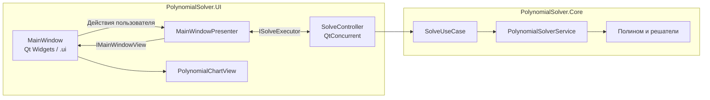

<div align="center">


<h1>PolynomialSolver</h1>

<p>Полиномиальные уравнения, интерактивный график и сравнение методов решения.</p>


<p>
<a href="#быстрый-старт">Быстрый старт</a> ·
<a href="#методы-решения">Методы</a> ·
<a href="#график-и-управление">График</a> ·
<a href="#архитектура">Архитектура</a> ·
<a href="#тестирование">Тесты</a>
</p>

</div>

---

Нативное приложение для решения полиномиальных уравнений **от первой до пятой степени**.
Изменяйте коэффициенты, наблюдайте за графиком и сохраняйте результаты расчётов
в истории. Математическое ядро написано на C++20; интерфейс — на Qt Widgets
с формой, доступной в Qt Designer.

## Возможности

| | Что умеет приложение |
| --- | --- |
| **Решение уравнений** | Аналитические методы для степеней 1–3 и бисекция для степеней 1–5 |
| **Сравнение методов** | Оба результата в одной записи; ошибка одного метода сохраняет результат другого |
| **Живой график** | Плавное изменение кривой, равный масштаб осей и наведение на найденные корни |
| **История расчётов** | Исходное уравнение, параметры, корни и невязки; выделение последней записи |
| **Удобный ввод** | Точка, запятая и научная запись чисел, подсветка ошибок без потери фокуса |
| **Фоновый расчёт** | Форма остаётся доступной для редактирования во время вычислений |

## Быстрый старт

### Что установить

| Компонент | Используемая конфигурация |
| --- | --- |
| Visual Studio | **2026**, средства разработки классических приложений на C++ |
| Компилятор и SDK | **MSVC v143**, Windows SDK |
| Qt | **6.12.0 → MSVC 2022 64-bit** |
| Модули Qt | Widgets, Charts, Concurrent; **Test** для тестового проекта |
| Интеграция с IDE | **Qt Visual Studio Tools** |

Проекты используют имя установки Qt **`6.12.0_msvc2022_64`**.
Зарегистрируйте свой комплект под этим именем в Qt VS Tools или выберите другую
установку в свойствах проекта **Qt Project Settings → Qt Installation**.

### Открыть и запустить

1. Откройте [`PolynomialSolver.sln`](PolynomialSolver.sln) как решение Visual Studio.
2. Выберите `PolynomialSolver.UI` запускаемым проектом.
3. Установите конфигурацию **Debug | x64** или **Release | x64**.
4. Нажмите **F5** для отладки или **Ctrl+F5** для запуска без отладчика.

Исполняемый файл создаётся в `build/msvc/x64/<Configuration>/PolynomialSolver.exe`.
Путь к библиотекам Qt при запуске из IDE настраивает Qt VS Tools.

> [!TIP]
> Для первого расчёта выберите степень **3**, введите коэффициенты
> **1, −6, 11, −6** и нажмите **«Решить»** в аналитическом режиме.
> Уравнение `x³ − 6x² + 11x − 6 = 0` имеет корни **1, 2 и 3**.

Форма [`MainWindow.ui`](src/PolynomialSolver.UI/MainWindow.ui) находится в группе
**Forms** и открывается в Qt Designer. Поля коэффициентов создаются динамически:
их количество зависит от выбранной степени.

## Методы решения

| Режим | Степени | Результат |
| --- | --- | --- |
| **Аналитический** | 1–3 | Вещественные и комплексные корни, включая повторения |
| **Бисекция** | 1–5 | Вещественные корни на заданном интервале |
| **Оба метода** | 1–3 | Отдельные результаты и ошибки каждого метода |

Для степеней **4 и 5** приложение автоматически выбирает бисекцию.

### Настройки бисекции

Откройте настройки кнопкой с шестерёнкой, задайте границы и нажмите **«Применить»**.
При первом численном запуске диалог откроется автоматически, если настройки ещё
не заданы; после применения нажмите **«Решить»** снова.

| Параметр | Назначение |
| --- | --- |
| **Левая и правая границы** | Конечные числа; левая граница должна быть меньше правой |
| **Знаки после запятой** | Запрашиваемая абсолютная точность координаты, от 0 до 15; по умолчанию 6 |
| **Найти все корни** | Включает предварительное сканирование интервала |
| **Шаг поиска** | Размер участка сканирования; по умолчанию 0.25, учитывается только при поиске всех корней |

В режиме **одного корня** бисекция работает со всем интервалом без сканирования.
На его концах должны быть разные знаки `P(x)` либо один из концов должен быть корнем.

В режиме **«Найти все корни»** приложение проверяет узлы сетки и уточняет участки
со сменой знака. Допускается не более **100 000 участков**.

> [!IMPORTANT]
> Сканирование не гарантирует нахождение каждого корня: кратный корень между узлами
> или несколько корней внутри одного шага могут быть пропущены.
> Шаг отвечает за обнаружение корней, а точность — за их последующее уточнение.

«Применить» сохраняет настройки. «Отмена» и закрытие диалога отбрасывают изменения.
Пустые коэффициенты и неконечные числа считаются ошибкой; старший коэффициент
не может быть нулём.

## График и управление

**Синяя линия** показывает полином, **красные точки** — найденные вещественные корни.
Единица по X и единица по Y всегда занимают одинаковое расстояние на экране.

| Действие | Поведение |
| --- | --- |
| Изменить коэффициенты | Кривая плавно обновляется, положение камеры сохраняется |
| Нажать **«Решить»** | После актуального результата камера плавно охватывает начало координат и найденные вещественные корни |
| Прокрутить колесо мыши | Приближение и отдаление относительно курсора |
| Перетащить левой кнопкой | Перемещение области просмотра |
| Нажать **«Сбросить вид»** | Начальные центр и масштаб, удаление маркеров |
| Нажать **«Очистить историю»** | Удаление записей без изменения уравнения и настроек |

Ручное управление прерывает автоматическое наведение. Изменение коэффициентов,
метода или применённых настроек убирает прежние маркеры. Комплексные корни
остаются в отчёте и не проецируются на ось X.

Масштаб **1:1** сохраняется и при наведении камеры: глубокие экстремумы могут
остаться за пределами экрана. Их можно рассмотреть вручную. На границе
представимого диапазона отступ вокруг корней уменьшается.

## История и фоновое выполнение

Каждый запуск сохраняет снимок уравнения и настроек. Если форму изменили во время
расчёта, завершённый результат попадёт в историю, но не заменит актуальный график.

- В записи видны метод, параметры, корни и невязки `|P(x)|`.
- Последний расчёт выделен полужирным; текст можно выделить и скопировать.
- Во время вычислений недоступен повторный запуск, но коэффициенты можно редактировать.
- Индикатор появляется после 150 мс, чтобы быстрые расчёты не вызывали мигания.
- После очистки истории нумерация снова начинается с 1.

История хранится в памяти текущего сеанса.

## Архитектура

В основном решении **два проекта**. Математика и сценарии находятся в Core;
Qt Widgets, отрисовка и фоновое выполнение — в UI.

```text
PolynomialSolver.sln
├── src/
│   ├── PolynomialSolver.Core/       # Полином, решатели, сценарии и численные настройки
│   └── PolynomialSolver.UI/         # MVP, форма Designer, график и исполнитель
└── tests/
    ├── PolynomialSolver.Tests.vcxproj
    └── QtTests/                    # Проверки ядра, Presenter и настоящих виджетов
```

| Компонент | Ответственность |
| --- | --- |
| **Core** | Модель полинома, алгоритмы, проверка численных настроек и сценарии решения; без зависимости от Qt |
| **MainWindowPresenter** | Состояние ввода, запуск, история и определение актуальности результата |
| **IMainWindowView / ISolveExecutor** | Контракты представления и выполнения расчёта |
| **MainWindow** | Создание динамических полей и отображение данных через Qt Widgets |
| **SolveController** | Выполнение в Qt Concurrent, занятость и доставка результата |
| **PolynomialChartView / PlotDataBuilder** | Рисование, камера, анимации и вычисления геометрии |

### Выбранные паттерны и причины выбора

| Паттерн | Где применяется | Какую задачу решает |
| --- | --- | --- |
| **MVP — Model–View–Presenter** | `MainWindow`, `MainWindowPresenter`, `IMainWindowView` | Отделяет состояние формы и правила взаимодействия от виджетов. Валидацию, запуск и актуальность ответа можно проверять с подменным View без создания окна. |
| **Strategy — стратегия** | `AnalyticalStrategy` и `BisectionStrategy` внутри `SolveUseCase` | Оба способа расчёта предоставляют `solve(request)` и выполняются через общий `runStrategy`. Это позволяет одинаково собирать результаты и ошибки при выборе одного метода или сравнении обоих. |
| **Facade — фасад** | `PolynomialSolverService` | Даёт сценарию единый вход в математические операции: создание полинома, выбор решателя, проверку конечности корней и вычисление невязок. Детали отдельных алгоритмов остаются внутри Core. |
| **Observer — наблюдатель** | Сигналы и слоты `SolveController`, callbacks в `ISolveExecutor` | Передаёт уведомления о занятости, индикаторе, результате и ошибке. Presenter реагирует на события расчёта, а рабочий поток оперирует собственными данными без обращения к виджетам. |

Стратегии реализованы небольшими внутренними объектами с общим контрактом вызова.
Граница между Presenter и исполнителем позволяет подменять фоновый расчёт в тестах,
а готовый механизм сигналов Qt обеспечивает событийное взаимодействие интерфейса.

<details>
<summary><strong>Связи компонентов</strong></summary>



</details>

## Тестирование

Отдельный проект [`PolynomialSolver.Tests.vcxproj`](tests/PolynomialSolver.Tests.vcxproj)
содержит **16 наборов Qt Test** и не загромождает основное решение.

Откройте тестовый проект отдельно, выберите **Debug | x64** или **Release | x64**
и запустите его. Без аргументов выполняются все наборы.

В свойствах отладки проекта можно указать аргументы:

```text
--suite MainWindowPresenterTests
```

Для XML-отчёта выберите один набор и имя файла:

```text
--suite QuadraticSolverTests -o quadratic-results.xml,junitxml
```

Именованные и структурированные отчёты требуют **ровно одного набора**, чтобы
файлы не перезаписывались и XML-документы не склеивались.

| Область | Что проверяется |
| --- | --- |
| Математика | Полином, решатели, численные регрессии, границы и сетка бисекции |
| Сценарии и MVP | Валидация, снимки запросов, актуальность ответа, история; подменные View и исполнитель |
| Фоновое выполнение | Отзывчивость цикла событий, повторный запуск, ошибки и уничтожение контроллера |
| Реальный интерфейс | Ввод, диалог, геометрия полей, фон после разворачивания, маркеры и камера |

UI-проверки по умолчанию используют `QT_QPA_PLATFORM=offscreen`.
Проверки рисования анализируют полученное изображение; они дополняют проверки
логики Presenter. Сборка и тесты проверены в **Debug** и **Release**.

## Численные ограничения

Приложение использует **`double`**. Запрос 15 знаков после запятой не означает,
что такая точность достижима на любом интервале. О недостижимой точности
бисекция сообщает ошибкой.

Невязка помогает оценивать ответ, но её конечность сама по себе не доказывает
заданную точность корня. Для субнормальных коэффициентов и сильно различающихся
порядков остаются ограничения численной устойчивости; общей гарантии корректности
для всех конечных комбинаций `double` нет.
