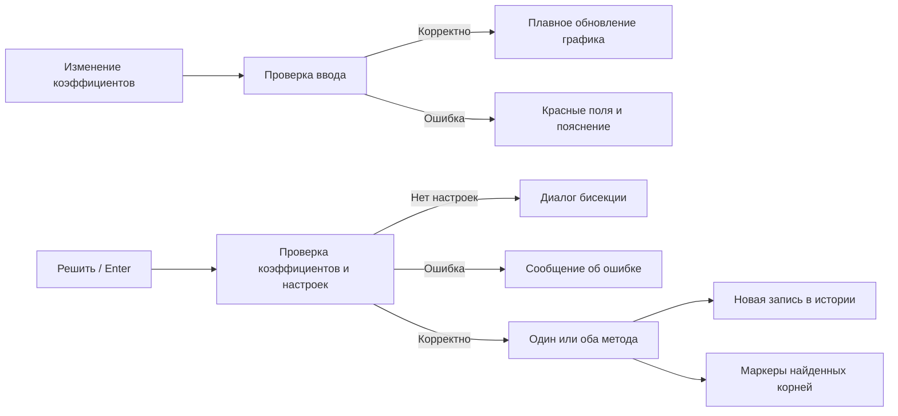

# PolynomialSolver

PolynomialSolver — нативное Windows x64-приложение для решения полиномиальных уравнений степеней от 1 до 5. Интерфейс построен на Qt 6 Widgets и Qt Charts, математическое ядро написано на C++20 и не зависит от Qt.

Коэффициенты можно редактировать непрерывно: график плавно меняется вместе с ними, а результаты явных запусков сохраняются в истории. Приложение показывает корни, метод решения и невязку `|P(x)|` для каждого корня. Поддерживаются точка, запятая и научная запись чисел.

## Требования

- Windows x64;
- Qt 6.11 или новее с компонентами Widgets, Charts и Test;
- MinGW 13.1;
- CMake 3.25 или новее;
- Ninja.

Пути проверенной конфигурации уже записаны в `CMakePresets.json`:

- Qt: `C:\Qt\6.11.2\mingw_64`;
- MinGW: `C:\Qt\Tools\mingw1310_64`;
- CMake: `C:\Qt\Tools\CMake_64`;
- Ninja: `C:\Qt\Tools\Ninja`.

## Сборка и тестирование

Из корня репозитория в PowerShell:

```powershell
$cmake = 'C:\Qt\Tools\CMake_64\bin\cmake.exe'
$ctest = 'C:\Qt\Tools\CMake_64\bin\ctest.exe'

& $cmake --preset debug
& $cmake --build --preset debug
& $ctest --preset debug
```

Release-сборка и создание автономной папки:

```powershell
& $cmake --preset release
& $cmake --build --preset release
& $ctest --preset release
& $cmake --install build/release
```

Готовое приложение:

```powershell
.\dist\PolynomialSolver\bin\PolynomialSolver.exe
```

В папке `dist\PolynomialSolver` находятся Qt DLL, плагины и MinGW runtime. Установленной копии Qt в `PATH` не требуется.

## Работа в Qt Creator

Откройте корневой `CMakeLists.txt`, выберите preset `PolynomialSolver: Qt Debug` или `PolynomialSolver: Qt Release`, настройте проект. Компилятор, Qt, CMake, Ninja и GDB берутся из `CMakePresets.json`. Сборка — Ctrl+B, запуск — Ctrl+R, отладка — F5.

После изменения presets выберите «Сборка → Перезагрузить CMake Presets». Локальные настройки Qt Creator хранятся в игнорируемом каталоге `.qtcreator`.

`src/PolynomialSolver.UI/MainWindow.ui` открывается в визуальном дизайнере. Поля коэффициентов создаются программно в зависимости от степени. Диалог бисекции реализован отдельно в `BisectionSettingsDialog`.

## Управление

1. Выберите степень 1–5 и введите коэффициенты. Значения сохраняются при переключении степени.
2. График отображается сразу и плавно обновляется при корректном изменении коэффициентов. Запускать решение для просмотра кривой не нужно.
3. Выберите «Аналитический», «Бисекция» или «Оба метода». Аналитическое решение и сравнение доступны для степеней 1–3; для 4–5 автоматически выбирается бисекция.
4. Для численного метода откройте «Настройки бисекции…», заполните интервал и нажмите «Применить».
5. Нажмите «Решить» или Enter в поле коэффициента. Если численные настройки ещё не заданы, сначала откроется их диалог; после применения нажмите «Решить» снова.
6. Продолжайте редактировать уравнение и запускать расчёты. Форма после решения остаётся доступной.

Ошибочные поля подчёркиваются красным сразу, пояснение появляется под полями ввода. Пустые коэффициенты, нечисловые и бесконечные значения недопустимы; старший коэффициент не может быть нулём. Пока коэффициенты некорректны, кривая скрыта. Исправление автоматически возвращает график и убирает подсветку, не перехватывая фокус. При нажатии «Решить» с ошибочным вводом дополнительно появляется сообщение об ошибке.

## Настройки бисекции

Настройки открываются отдельным модальным диалогом. Обе границы изначально пустые и обязательны; левая должна быть меньше правой. Точность задаётся количеством знаков после запятой (0–15, по умолчанию 6).

**Флажок «Найти все корни» выключен:** шаг скрыт, предварительный поиск не выполняется. Метод бисекции применяется непосредственно ко всему указанному интервалу и возвращает один корень. На концах должны быть разные знаки `P(x)` или один из концов должен быть корнем. Одинаковые ненулевые знаки вызывают объясняющую ошибку; это не доказывает отсутствия корней внутри интервала.

**Флажок включён:** появляется поле «Шаг поиска» (по умолчанию 0.25). Сначала интервал сканируется с этим шагом. Участки со сменой знака уточняются бисекцией, корни на узлах и границах также учитываются. Последний участок при необходимости сокращается до правой границы.

Сканирование не гарантирует полноту: кратный корень между узлами или несколько корней внутри одного шага могут быть пропущены. Уменьшение шага повышает детализацию поиска, а точность отвечает за уточнение найденных корней. Допускается не более 100 000 участков. Слишком мелкий шаг, не позволяющий продвинуться к следующей точке, отклоняется. Если запрошенная точность недостижима, решение сообщает об этом.

«Применить» сохраняет только корректные настройки и закрывает диалог. «Отмена» или закрытие окна отбрасывают черновик. В режиме одного корня скрытый шаг не участвует в проверке. Применённые настройки сохраняются до завершения приложения.

## История и сравнение

Каждое решение добавляет в моноширинный журнал номер расчёта, уравнение, метод, численные параметры, корни и невязки. Последняя запись выделена фоном. Текст можно выделить и скопировать.

В режиме «Оба метода» результаты находятся в одной записи с отдельными заголовками. Аналитический метод показывает все корни, включая комплексные и повторения; бисекция — вещественные корни указанного интервала в выбранном режиме. Если один метод завершился ошибкой, результат другого сохраняется, а ошибка подписана своим методом и дополнительно показана сообщением.

«Очистить историю» удаляет записи, сохраняя уравнение, график и настройки. История хранится в памяти текущего сеанса.

## График

- Синяя линия — полином, красные точки — различные найденные вещественные корни.
- Новое уравнение плавно изменяет линию и диапазоны за 200 мс, переиспользуя существующие серии. Повторный ввод перенаправляет текущую анимацию к последним данным.
- При изменении коэффициентов старые маркеры корней убираются до следующего решения.
- Колесо мыши масштабирует относительно курсора; перетаскивание левой кнопкой перемещает область.
- «Сбросить вид» возвращает автоматически рассчитанный диапазон.
- Масштабирование и перемещение останавливают текущую анимацию и передают управление пользователю.

Разделитель между историей и графиком можно перемещать мышью.

## Архитектура

`PolynomialSolver.Core` не зависит от Qt. `PolynomialSolverService` выбирает аналитический решатель или численный путь, вычисляет невязки. `BisectionSolver::solveOne` уточняет один корень без сканирования; `BisectionSolver::solve` сканирует интервал и уточняет найденные участки.

`BisectionSettingsDialog` разделяет черновик и применённые настройки. `MainWindow` проверяет коэффициенты, обновляет предпросмотр, запускает методы и добавляет записи в журнал. `PolynomialChartView` управляет сериями, анимацией и взаимодействием, а `PlotDataBuilder` независимо вычисляет диапазоны и выборку.



## Тесты

11 наборов Qt Test покрывают математическое ядро, численные режимы и ограничения сканирования, маршрутизацию сервиса и невязки, парсер локализованного ввода, подготовку графика, плавный переход и повторный ввод, масштабирование и перемещение, применение/отмену настроек, немедленную валидацию, историю и сравнение методов.

UI-тесты запускаются с `QT_QPA_PLATFORM=offscreen` и не зависят от снимков экрана.

## Лицензирование

Перед внешним распространением приложения необходимо отдельно проверить условия лицензирования используемой поставки Qt и модуля Qt Charts.
